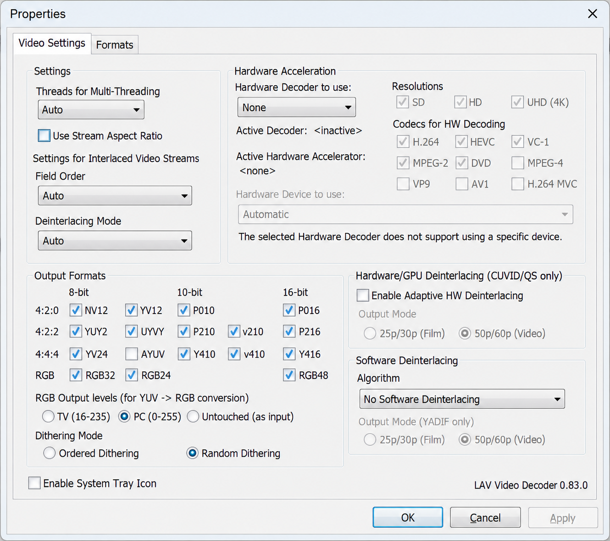
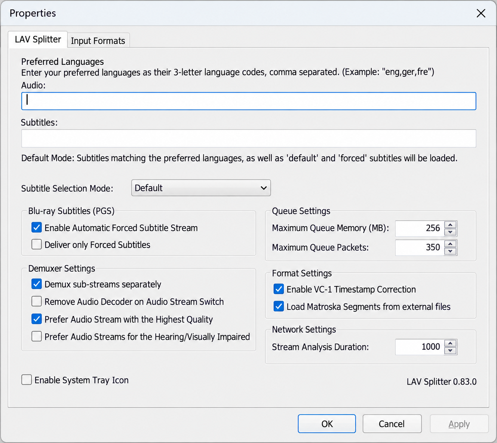
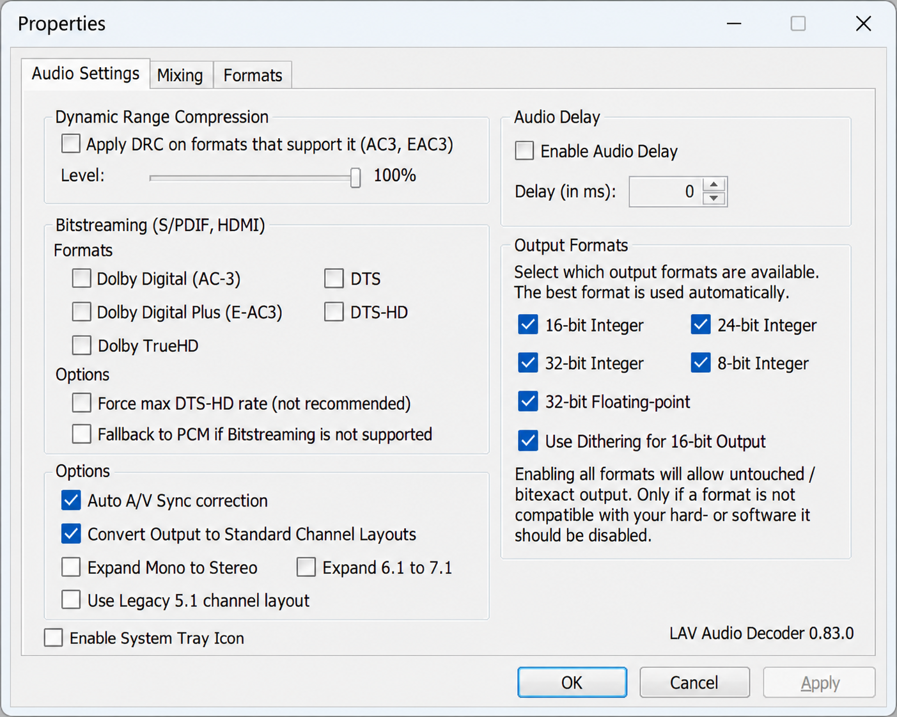

# Lav Filters - FFmpeg-Based DirectShow Splitter And Decoders

## Overview

Lav Filters is a set of DirectShow filters built around FFmpeg libraries. The Lav Filters repository maintained by Lav Filters Codec provides Lav Splitter, Lav Video Decoder, and Lav Audio Decoder for playing multimedia in compatible Windows applications.

Lav Filters supports common containers such as MKV/WebM, AVI, MP4/MOV, TS/M2TS/MPG, FLV, OGG, and Blu-ray playlists. Format and codec availability depends on the Lav Filters version and its bundled FFmpeg configuration.

### Lav Filters Terms

lav filters, lav filters codec, lav splitter, lav video decoder, lav audio decoder, lav decoder, directshow, ffmpeg, video-decoder, audio-decoder, media-splitter, hardware-acceleration, windows-codecs, bitstreaming

### What do lav filters do?

Lav Filters connects media sources to a DirectShow playback graph. Lav Splitter reads a container, identifies its video, audio, subtitle, attachment, and metadata streams, and exposes selected streams through output pins. The demuxing implementation is centered on [LAVFDemuxer.cpp](demuxer/Demuxers/LAVFDemuxer.cpp), while [LAVSplitter.cpp](demuxer/LAVSplitter/LAVSplitter.cpp) implements the DirectShow splitter filter.

Lav Video Decoder receives compressed video and produces frames suitable for a renderer. It can use FFmpeg software decoding or supported hardware-acceleration paths selected through [DecodeManager.cpp](decoder/LAVVideo/DecodeManager.cpp). Lav Audio Decoder performs audio decoding, post-processing, format negotiation, and optional bitstreaming through components such as [LAVAudio.cpp](decoder/LAVAudio/LAVAudio.cpp), [PostProcessor.cpp](decoder/LAVAudio/PostProcessor.cpp), and [Bitstream.cpp](decoder/LAVAudio/Bitstream.cpp).

Together, Lav Filters Codec components let a DirectShow player delegate container parsing, lav video codecs, audio decoding, stream selection, and hardware decoding to Lav Filters. They are filters rather than a standalone media player.

## Install

The Lav Filters installer registers the Lav Splitter, Lav Video Decoder, and Lav Audio Decoder components. Registration requires administrative rights. Both 32-bit and lav filters 64 bit components may be required when 32-bit and 64-bit DirectShow applications are used on the same machine.

Lav Filters Windows 10 and lav filters Windows 11 installations may coexist with other DirectShow filters. Filter merit and player-specific preferences determine which splitter or decoder is selected.

## Using it

Lav Splitter registers for supported media formats and creates output streams for the DirectShow graph. Other splitters with aggressive registration settings can take priority, so the player may need to select Lav Splitter explicitly.

Lav Video Decoder and Lav Audio Decoder register with relatively high merit. Many DirectShow players also provide per-player controls for choosing the preferred lav decoder.

Lav Filters settings are exposed through property pages:

- Lav Splitter settings are implemented by [SettingsProp.cpp](demuxer/LAVSplitter/SettingsProp.cpp).
- Lav Video Decoder settings are implemented by [VideoSettingsProp.cpp](decoder/LAVVideo/VideoSettingsProp.cpp).
- Lav Audio Decoder settings are implemented by [AudioSettingsProp.cpp](decoder/LAVAudio/AudioSettingsProp.cpp).

### Hardware Acceleration

Lav Filters hardware acceleration is coordinated by the video decode manager. This source selection includes lav filters D3D11 through [d3d11va.cpp](decoder/LAVVideo/decoders/d3d11va.cpp) and lav filters DXVA2 through [dxva2dec.cpp](decoder/LAVVideo/decoders/dxva2dec.cpp).

Names such as lav filters NVIDIA CUVID and lav filters Intel QuickSync may appear in discussions or older configurations. Their availability depends on the exact release, build configuration, graphics driver, and FFmpeg integration. The selected source files directly establish D3D11VA, DXVA2, and FFmpeg software decoding paths.

Hardware decoding should be enabled only when the GPU, driver, codec profile, bit depth, and output format are compatible. Software fallback is handled through [avcodec.cpp](decoder/LAVVideo/decoders/avcodec.cpp).

### Video And Audio Formats

The bundled FFmpeg configuration determines support for lav filters AV1 decoder, lav filters HEVC decoder, lav filters VVC decoder, and related formats. Features such as lav filters Dolby Vision processing can additionally depend on container metadata, decoder support, and the downstream renderer.

Lav Filters TrueHD Atmos playback may use decoded PCM or lav filters bitstreaming. Bitstreaming sends a compatible compressed stream to an external receiver without decoding it to PCM inside Lav Audio Decoder. Device and receiver compatibility remain necessary.

## Automatic Stream Selection

Lav Splitter automatically selects streams when opening a file. Video selection favors the best available video stream and is not configured through the language rules.

Audio selection accepts preferred three-letter ISO 639-2 language codes separated by commas or spaces:

`eng ger fre`

This order first searches for English, then German, and then French. When multiple tracks match, Lav Splitter considers attributes such as channel count and codec quality, generally preferring lossless audio over lossy alternatives.

Subtitle selection provides four modes:

#### No Subtitles

Lav Splitter starts without selecting a subtitle stream.

#### Only Forced Subtitles

Lav Splitter selects subtitles marked as forced while respecting preferred languages.

#### Default

Lav Splitter selects a matching preferred language. Default or forced flags influence selection, while no matching language normally leaves subtitles disabled.

#### Advanced

Advanced rules pair an audio language with a subtitle language:

`eng:ger`

This rule selects German subtitles when the active audio is English. An asterisk matches any language, while `off` disables subtitles:

- `*:eng` selects English subtitles for any audio language.
- `eng:*` selects any subtitle language for English audio.
- `eng:off` disables subtitles when the audio is English.

Subtitle tokens can contain flags after a pipe:

- `d` matches default subtitles.
- `f` matches forced subtitles.
- `h` matches hearing-impaired subtitles.
- `n` matches streams without default, forced, or hearing-impaired flags.
- `!` negates the flags that follow it.

Rules are evaluated from left to right, and the first match takes precedence:

`eng:eng|f eng:ger|f eng:off *:eng *:ger`

This rule set prefers forced English or German subtitles for English audio, otherwise disables subtitles for that audio. For other audio languages, it selects English or German subtitles.

A stream-title match can be appended with `@`:

`*:eng@Forced`

This selects an English subtitle whose title contains the single-word match `Forced`.

## Blu-ray Support

Lav Splitter can open a Blu-ray `index.bdmv` file and select the longest detected title, which is commonly the main feature. It can also open a specific `.mpls` playlist.

Blu-ray behavior depends on the disc structure, playlist information, encryption status, and the libbluray version used by the build.

## Libraries

Lav Filters Codec relies on FFmpeg multimedia libraries:

| Library | Role In Lav Filters |
|---|---|
| `libavcodec` | Implements video and audio codec decoding. |
| `libavformat` | Parses containers, streams, protocols, and media input. |
| `libavutil` | Provides shared multimedia utilities and data structures. |
| `libavfilter` | Provides graph-based media filtering facilities. |
| `libswresample` | Performs audio conversion, mixing, and resampling. |
| `libswscale` | Performs pixel-format conversion and video scaling. |

The common FFmpeg side-data interface is declared in [IMediaSideDataFFmpeg.h](common/includes/IMediaSideDataFFmpeg.h).

## System Requirements

Lav Filters targets Windows DirectShow environments. Practical requirements include:

- Windows 10 or Windows 11.
- An x86 or x64 DirectShow application.
- A compatible graphics driver for lav filters hardware acceleration.
- A compatible audio device and receiver for lav filters bitstreaming.
- Visual Studio 2022 and NASM when compiling the full source tree.

## Layout

| Path | Purpose |
|---|---|
| [demuxer/LAVSplitter/LAVSplitter.cpp](demuxer/LAVSplitter/LAVSplitter.cpp) | Implements the Lav Splitter DirectShow filter. |
| [demuxer/Demuxers/LAVFDemuxer.cpp](demuxer/Demuxers/LAVFDemuxer.cpp) | Integrates FFmpeg container demuxing. |
| [decoder/LAVVideo/LAVVideo.cpp](decoder/LAVVideo/LAVVideo.cpp) | Implements the Lav Video Decoder filter. |
| [decoder/LAVVideo/DecodeManager.cpp](decoder/LAVVideo/DecodeManager.cpp) | Selects and manages video decoding backends. |
| [decoder/LAVAudio/LAVAudio.cpp](decoder/LAVAudio/LAVAudio.cpp) | Implements the Lav Audio Decoder filter. |
| [decoder/LAVAudio/BitstreamParser.cpp](decoder/LAVAudio/BitstreamParser.cpp) | Parses supported compressed audio streams. |
| [common/includes/version.h](common/includes/version.h) | Defines Lav Filters version information. |
| [resources/LAVFilters.Dependencies.manifest](resources/LAVFilters.Dependencies.manifest) | Describes runtime assembly dependencies. |

## Compilation

Lav Filters Codec can be compiled with Visual Studio 2022 using [LAVFilters.sln](LAVFilters.sln). The primary Windows build entry point is [build.bat](build.bat).

FFmpeg must be built before the DirectShow filters. The repository provides [build_ffmpeg.sh](build_ffmpeg.sh) and [build_ffmpeg_msvc.sh](build_ffmpeg_msvc.sh) for the supported FFmpeg build paths. NASM is required for optimized x86 and x64 assembly.

Shared compiler and platform settings are maintained in [common.props](common/common.props) and [platform.props](common/platform.props). Individual Visual Studio projects include:

- [LAVSplitter.vcxproj](demuxer/LAVSplitter/LAVSplitter.vcxproj)
- [LAVVideo.vcxproj](decoder/LAVVideo/LAVVideo.vcxproj)
- [LAVAudio.vcxproj](decoder/LAVAudio/LAVAudio.vcxproj)

The installer definition is stored in [LAVFilters.iss](LAVFilters.iss). Automated build behavior is described by [build.yml](.github/workflows/build.yml).

## Release Cycle

Lav Filters releases evolve with FFmpeg, Windows, hardware APIs, and codec support. Searches for lav filters 0.74.1, lav filters 0.75, or lav filters 0.83.0 refer to different snapshots with potentially different decoder backends and supported formats.

Consult [CHANGELOG.txt](CHANGELOG.txt) before comparing releases or changing lav filters video decoder settings. A newer version may alter codec support, hardware behavior, compatibility, or defaults. The question “lav filters should I remove it” depends on whether installed DirectShow applications rely on Lav Splitter, Lav Video Decoder, or Lav Audio Decoder.

## Contributing

Changes to Lav Filters should preserve DirectShow interfaces, media negotiation, stream timestamps, decoder fallback behavior, and architecture-specific code paths. Formatting conventions are defined in [.clang-format](.clang-format) and [.editorconfig](.editorconfig).

Changes involving optimized decoding should be validated against the reference implementation and tested for output correctness, stack integrity, register preservation, alignment, and supported CPU features. Build changes should be checked for both applicable Windows architectures.

## License

Lav Filters licensing terms are provided in [COPYING](COPYING).

## Feedback

When reporting a Lav Filters Codec problem, include the Lav Filters version, Windows version, player architecture, input format, codec, selected decoder, hardware backend, graphics driver, and reproducible symptoms. Distinguish decoding failures from splitter, renderer, device, and bitstreaming failures.
